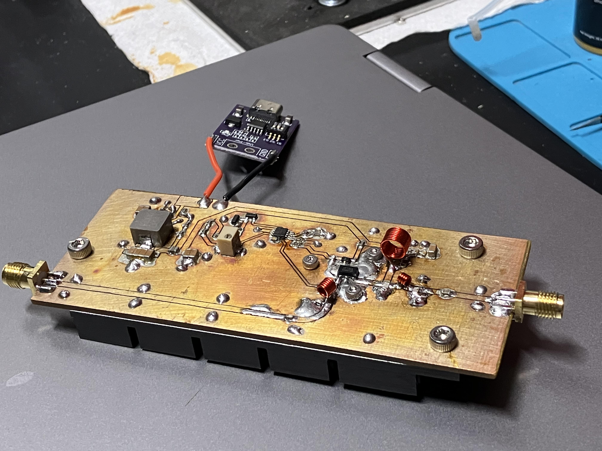
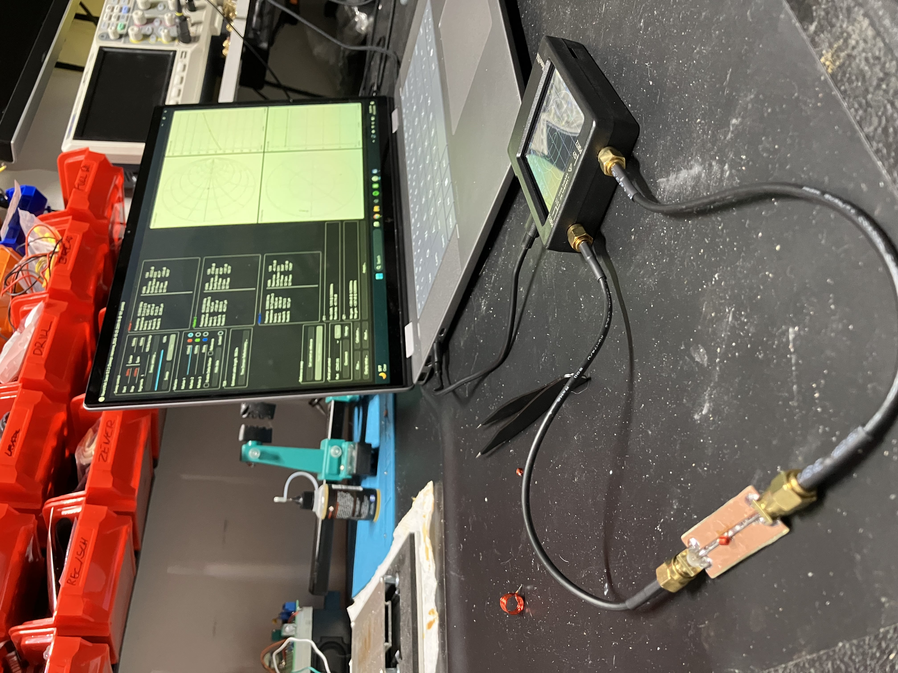

# 5W RF amplifier for 2m HAM band

*V1.0 completed October 25th, 2026*

A 5W PA for transmitting on the 2m band, centered around the AFT05MS004NT1.

## Specifications

* **Transistor:** AFT05MS004NT1 LDMOS
* **Operating band:** 144-148MHz
* **Amplifier class:** AB
* **Quiescent bias:** 100mA
* **Input VSWR:** ~1.1 @ 146MHz
* **Input drive power:** ~15mW (+11.7 dBm)
* **Max power out:** ~5W (+37dBm) @ 146MHz
* **Power gain:** ~25dB @ 146MHz
* **Drain efficiency:** unmeasured
* **PCB:** 2-Layer custom PCB with embedded copper coin manufactured at home
* **Power supply:** LMR51420XDDCR buck converter w/ shielded inductor supplies 7.5V to the LDMOS drain with any Vin from +7.5V to +25V

## Architecture

* **Input matching:** At 145MHz, the AFT05MS004NT1 datasheet specifies an optimal Zsource of 9.05+j12.43Ω to match its input impedance to 50Ω. This was done with a 47pF generator side shunt capacitor and a 24nH series inductor in an L-network.
  
* **Power stage:** The amplifier uses a single stage, common source Class AB topology built around the AFT05MS004NT1 LDMOS, biased at a quiescent drain current of 100mA from a 7.5V supply. An adjustable dc bias with thermal compensation is applied to the gate through a 1kΩ resistor. Drain power is fed through an RF choke of 220nH, bypassed with multi-value decoupling capacitors to present a low impedance RF ground across VHF and lower frequencies.
  
* **Output matching:** To match its output to 50Ω, the AFT05MS004NT1 requires a load impedance of 2.54-j0.54Ω. This results in a very large impedance transformation, and the resulting matching stage is very sensitive to component tolerances. I arrived at a pi-network design: 15pF generator shunt capacitor, 12nH series inductor, 100pF load side shunt capacitor. This matching networks also acts as a low pass filter, helping to reconstruct the original waveform of the input.

## Challenges

* **Amplifier stability:** Wideband RF LDMOS devices such as the AFT05MS004NT1 exhibit high gain well below their rated VHF/UHF operating range, making the transistor prone to self-oscillation. Good layout practice along with a 3.3Ω attenuator pad at the gate was used to prevent this oscillation.
  
* **Impedance matching:** 
* Output: Designing matching networks for a 2-layer homemade RF board was challenging because the AFT05MS004NT1 requires very low terminal impedances, notably the 2.5Ω load impedance at the drain represents roughly a 20:1 impedance transformation ratio to 50Ω. At VHF, even 1-2nH of unmodeled lead or trace inductance shifts the match noticeably. For fine tuning, values were refined by VNA measurements on a board with identical trace parasitics. 

* Input: A previous matching network had a much larger 330pF generator side shunt capacitor and, while numerically matched, the resulting RF output was only ~1.5W. The low 15pF generator side shunt capacitance stops high currents from travelling through the shunt and loading down the drain, resulting in the expected 5W output. The input matching was tricky due to the rather long 50Ω trace leading into the matching network from the input port. Initial calculations were made for an L network with a source impedance of 9.05+j12.43Ω giving a generator side shunt capacitor of 39pF and a series inductor of 38nH. In practice, this network had an input VSWR of ~3.6 and required fine tuning. The final network of 47pF generator side shunt capacitor and 24nH series inductance gives an input VSWR of 1.124 at 146MHz.

  
* **Thermal interface:** Because the AFT05MS004NT1 dissipates up to 2.5W and comes in SOT-89, a very small SMD package, it requires the board to have a thermally conductive channel to dissipate heat. With a home made PCB, in-pad thermal vias are very difficult. Instead I modeled a rectangle underneath the source of the AFT05MS004NT1 to be cut out and replaced with a custom milled copper rectangle. The top and bottom of the copper was soldered to the ground plane, and the bottom solder is milled flat with the board to achieve an excellent thermal interface from the heatsink to the LDMOS. This process also results in quite a bit of solder on the front of the board.

* **Thermal compensation:** As the device claims to dissipate 2.5W at maximum output, I decided temperature compensation was necessary for the quiescent bias of the amplifier. As the temperature of the LDMOS goes up, its gate threshold voltage goes down. In the event that the transistor were to heat up, it would draw even more power and heat up more, thermal runaway. The AFT05MS004NT1's gate threshold voltage drops at approximately 2.2mV/°C. To achieve thermal compensation I summed my adjustable DC bias with the voltage drop of a BAS16W diode located on the same thermal interface as the LDMOS. The BAS16W diode drop decreases at about 1.9mV/°C, so the summing amplifier has 1.245x gain to bring that just above the negative temperature coefficient of the LDMOS gate.
  
* **Switching converter on an RF board:** Any RF amplifier needs a very solid, noise free power supply. Achieving this with a switching converter requires very careful layout and part selection to avoid interference with the RF components. Switching loops were made as small as possible and decoupling capacitors placed very tightly with good ground plane continuity. A shielded inductor was used to minimize radiated emissions from the converter. To minimize any remaining ripple on the supply, the +7.5V goes through a pi low pass filter, achieving ~40dB reduction in the fundamental switching frequency.
